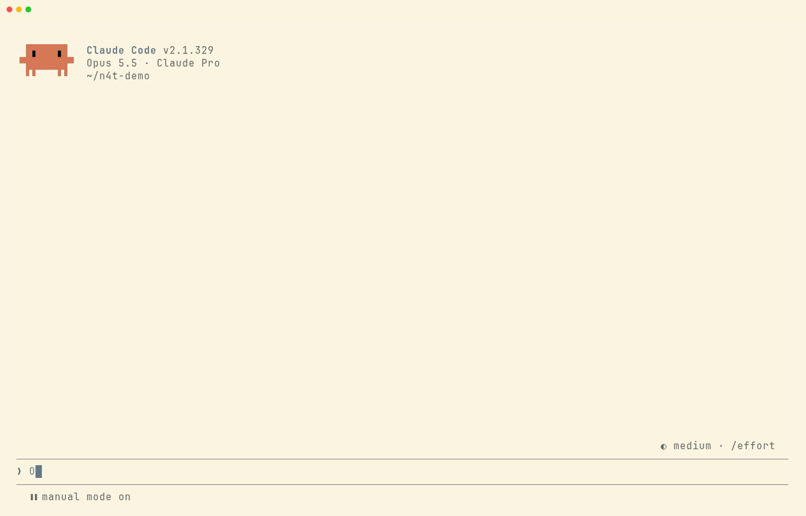

# Nickel4Thoughts (n4t)

[BLUF (Bottom Line Up Front)](https://en.wikipedia.org/wiki/BLUF_(communication))
answer validation for Claude Code, as one Rust binary.

Long answers bury the result. BLUF puts it first: the bottom line, then the
detail, the evidence and the caveats, each with a word budget. n4t makes Claude
Code follow that format and checks every final answer against it.

A `UserPromptSubmit` hook tells Claude to write the final answer of a turn as a
[Nickel](https://nickel-lang.org/) record. A `MessageDisplay` hook replaces that record on screen with
rendered Markdown. A `Stop` hook validates it and blocks the turn when a rule is
broken, naming the rule.

Claude writes the answer as a Nickel record. Nickel4Thoughts renders it as
Markdown for the user, as shown in the recording below.



## Prerequisites

- Linux. n4t is tested and in use on Linux. Other platforms are untested.
- Claude Code
- A Rust toolchain, 1.89 or later
- [just](https://github.com/casey/just)
- [Nushell](https://www.nushell.sh/), for the install recipes
- `jq`, used by the Justfile

## Install

```sh
just install     # builds, then registers all three hooks in ~/.claude/settings.json
just uninstall   # removes the n4t hooks, leaves the rest of settings.json alone
```

Both recipes are written in Nushell, so `nu` has to be on PATH. They read
`settings.json` as JSON and change only the hook entries that run n4t. Hooks
of other tools and all other settings stay as they are. Both recipes are
idempotent: running one twice gives the same result as running it once.

> [!NOTE]
> `just install` writes absolute paths into `settings.json`. Claude Code does
> not expand `${CLAUDE_PROJECT_DIR}` for a hook registered with `args`.

## Configuration

The word budgets and the sentence length can be changed in
`~/.config/n4t/config.ncl` (or `$XDG_CONFIG_HOME/n4t/config.ncl`). Without
that file the defaults apply.

`just install` places `config.skel.ncl` next to it, with the defaults and
examples. Every install overwrites the skeleton. `config.ncl` is never
overwritten. To start a config, copy the skeleton:

```sh
cp ~/.config/n4t/config.skel.ncl ~/.config/n4t/config.ncl
```

A config only needs the values you want to change. Everything else keeps its
default:

```nickel
{
  budgets = {
    bottom_line = 150,
  },
  sentence_length = 30,
}
```

Each answer sets its language in the `language` field. The rule Claude
receives asks for the language the answer is written in. n4t does not detect
the language itself. `default_language` only applies when an answer leaves
the field out. Without the setting it is English.

All three hooks read the same config. The limits in the rule Claude receives
are the limits the Stop hook checks. If a file has an error, n4t uses the
defaults and tells Claude about the error. `n4t config` shows the current
limits, the languages and any error.

## Use without Claude Code

```sh
n4t check answer.ncl   # validate, print the diagnosis, exit non-zero on violation
n4t fmt answer.ncl     # render as Markdown
n4t config             # show the limits in effect
```

`check` and `fmt` take a file that holds either the Nickel record on its own
or a whole answer with the record in a `nickel` code block.

## Languages

n4t works with answers in any language and any script. Most rules do not
depend on the language: word budgets, sentence length, dashes, placeholders,
and a bottom line that ends in a question mark of any script.

Everything that does depend on the language lives in a language pack: the
headings of the rendered answer, the phrase lists that catch preambles,
hedging, filler, meta comments and apologies, and optional checks written in
Nickel. n4t ships packs for English and German, the two languages I write in.
n4t uses the pack named in the answer's `language` field. A language without
a pack gets English headings and the universal rules by default.

A pack is a Nickel file named after its language,
`~/.config/n4t/languages/<tag>.ncl`:

```nickel
{
  labels = {
    bottom_line = "En bref",
    caveats = "Limites",
  },
  phrases = {
    hedging = ["peut-être", "je pense", "probablement"],
    filler = ["en fait", "au final"],
  },
  checks = {
    no_digits = fun text =>
      if std.string.is_match "[0-9]" text then 'Violation "spell out numbers" else 'Ok,
  },
}
```

- **Phrases** are plain text, matched as whole words and ignoring case. n4t
  escapes them before it builds a pattern, so a pack cannot break the
  matcher or slow it down. The categories are fixed: `preamble`,
  `question_comment`, `summary`, `hedging`, `forward_reference`, `meta`,
  `apology`, `filler`, `spelling`.
- **Labels** left out stay English.
- **Checks** take the prose of one field, Markdown removed, and return `'Ok`
  or `'Violation "message"`. They run in the Stop hook only, after every
  other rule has passed.
- A pack in `~/.config/n4t/languages/` named like a built-in pack (`en.ncl`,
  `de.ncl`) changes that pack. The headings and phrase lists it sets replace
  the built-in ones, everything else stays. An empty list switches a category
  off. If it has checks, they replace the built-in checks.

A pack is Nickel code, so it can compute its lists. The shipped German pack
derives the ASCII spellings (`zunaechst` for `zunächst`) from its word list
instead of listing both. The built-in packs in [`languages/`](languages/)
serve as examples for headings and phrase lists, the example above for a
check.

Word budgets and sentence length count words with the word segmenter of
[ICU4X](https://github.com/unicode-org/icu4x), the Unicode Consortium's
internationalization library. It also finds word boundaries in languages that
put no spaces between words. Its
[documentation](https://docs.rs/icu_segmenter/) lists them.

## Development

```sh
just check   # cargo test + clippy + fmt + the schema and hooks end to end
just bench   # measure the render hook, target is under 20 ms
```

[Golden files](https://en.wikipedia.org/wiki/Characterization_test) for the
rendering live in `tests/golden/`. After an intentional change to the output,
rewrite them with `N4T_UPDATE_GOLDEN=1 cargo test --test render` and read the
diff before committing.

## Design

### Functional core

The rules are plain functions. Each takes a string and returns `Ok(())` or a
violation that names the problem and the fix. `Answer::validate` runs them
field by field and stops at the first violation, so Claude gets one concrete
thing to fix instead of a list. The rules read no files and start no
processes. A test passes a sentence to a rule and checks the result, without
Claude Code or hook payloads.

Nickel turns the record into a typed `Answer` value before the rules run
(parse, don't validate). A missing field, a misspelled key or an unknown
`confidence` value fails at that step, with Nickel's error message.

The alternative would be to hand every rule the raw record and let each one
check the fields it reads. The same check would then be repeated in many
places, and a rule that skips it would fail on a malformed record. Parsing
once is better: the type guarantees the structure of the record and spares
every rule its own structure check. Whether the text itself holds up is left
to the rules.

### Imperative shell

Files are read and written in three places only: the hooks in `src/hooks/`,
the config loader in `src/config.rs` and the `check` and `fmt` commands in
`src/main.rs`. The hooks work like this:

- Claude Code starts n4t once per hook event. Each hook is a subcommand of the
  same binary. It reads the event as JSON from stdin and writes its reply to
  stdout.
- Claude Code hands the Stop hook Claude's last answer as text, in the field
  `last_assistant_message`.
- The display hook is called several times per answer. Between calls it keeps
  the partial record in `$XDG_RUNTIME_DIR`, a directory in RAM that only the
  current user can access. Without that variable it falls back to `/tmp`.

The record itself is evaluated from memory. Nickel only reads the schema it
imports.

### Fail-open

When something goes wrong, n4t lets the answer through. The display hook only
changes what is shown on screen. The transcript keeps the original text. If
the hook fails or times out, Claude Code shows the raw record. The Stop hook
passes anything that is not clearly a finished answer, because a wrong block
costs a whole turn and a wrong pass costs nothing.

Nickel can recurse without end, and packs are Nickel code. Every evaluation
therefore runs on its own thread and is abandoned after 2 seconds. A check
that fails or runs too long lets the answer through.

### Who checks what

The display hook only checks the structure of the record before it renders
it. The prose rules and the checks of the language packs run in the Stop hook,
once per turn. A record that breaks a prose rule is shown rendered, and the
Stop hook then asks Claude for a corrected answer.

### Known limitation

Claude Code runs the display hook only while an answer streams. When it
redraws earlier messages from the transcript, for example after `/resume` or
after a menu has covered the screen, it does not run the hook again. Those
messages then show the raw record. No other hook can change how earlier
messages are displayed.

### Streaming

The display hook receives the answer in batches while it streams. It collects
the record up to the closing fence and replaces it only then. Batches can be
flushed concurrently, so they are ordered by index.

## How the work is split

Nickel reads the record and checks its structure with a
[contract](https://nickel-lang.org/user-manual/contracts). Rust does
everything else.

| Task | Where |
|---|---|
| Record structure (fields, types, enum values) | `schema/answer.ncl` |
| Evaluating Nickel with `nickel-lang-core`, error messages | `src/nickel.rs` |
| Rules and word budgets | `src/rules.rs` |
| Language packs (headings, phrase lists, checks) | `languages/` |
| Running the checks of a pack | `src/checks.rs` |
| Loading limits and language packs | `src/config.rs` |
| Markdown rendering | `src/render.rs` |
| Hook input and output | `src/hooks/` |

Why Nickel? The record is real
[Nickel syntax](https://nickel-lang.org/user-manual/syntax), with
`m%"..."%` strings, enum tags and `import`. A parser of our own for that would
be a second project.

Why Rust for the rest? Speed. The rules use regular expressions. Rust compiles
them once per process. As Nickel contracts, they were compiled again for every
rule and every field, which took 22 of 32 ms per answer. One binary also
replaces the shell scripts and `jq` calls a hook would otherwise need.

## Error messages

When the Stop hook blocks a turn, its message is all Claude has to fix the
answer. So the message names the field, the broken rule and the fix:

```text
contract broken by the value of `supporting_detail`
299 words, limit is 200
Cut 99 of them.
```

The prose rules run in Rust and build this text themselves. Errors from Nickel
(syntax, structure, enum tags) come from `nickel-lang-core` as structured
diagnostics through its `IntoDiagnostics` trait. n4t keeps their message and
notes. It leaves out source excerpts and box drawing, because they do not help
Claude fix the answer. A syntax error also gets its line and column, and a hint
when the source shows the cause.

## Notes

- [`nickel-lang-core`](https://docs.rs/nickel-lang-core/0.19.0/nickel_lang_core/)
  is pre-1.0 and breaks its API between minor versions. The
  version is pinned exactly and `Cargo.lock` is committed.
- It is built with `default-features = false`. Its default features serve the
  `nickel` CLI rather than an embedder: `repl` is an interactive shell,
  `format` a tree-sitter formatter, `markdown` a terminal renderer, `doc` a
  documentation generator. Dropping all four takes the dependency count from
  314 to 165. What remains is the interpreter itself: parser, exact arithmetic,
  diagnostics, the hashes behind `std.hash`, the export formats.
- `icu_segmenter` adds about 2.4 MB of dictionaries and models to the binary
  and is licensed under Unicode-3.0.
- The Nickel stdlib is embedded in the binary. Nickel reads only `schema/` at
  runtime. `N4T_SCHEMA_DIR` overrides where it is looked for.
- `N4T_HOOK_LOG=<path>` records every Stop hook decision and every display
  hook flush that had to wait.
- `N4T_CONFIG_DIR=<path>` overrides the config directory.
- The Stop hook blocks with the flat `{decision, reason, suppressOutput}`
  shape. The nested `hookSpecificOutput` variant the docs describe was measured
  against Claude Code 2.1.235 and does not block. Worth rechecking after an
  upgrade.

## AI Disclosure

Development was assisted by AI tools (Claude, OpenCode, Junie).

## Contributing

I built n4t for my own workflow. To keep it focused, I am not accepting
external contributions. It is provided as-is under the MIT license.

## License

MIT License. See [LICENSE](LICENSE) for details.
